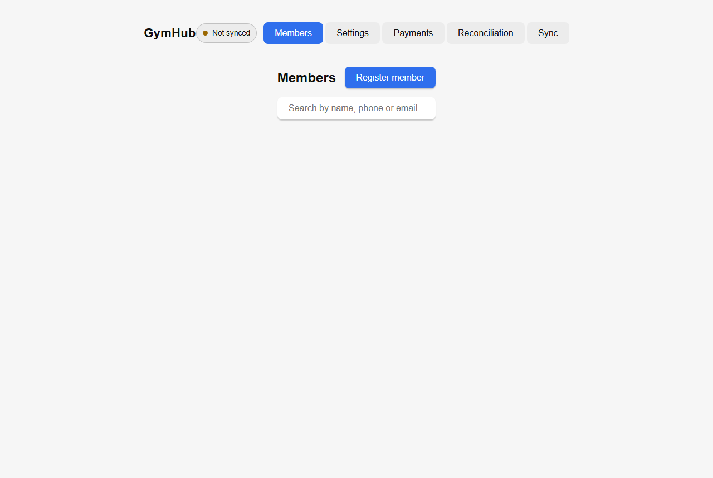
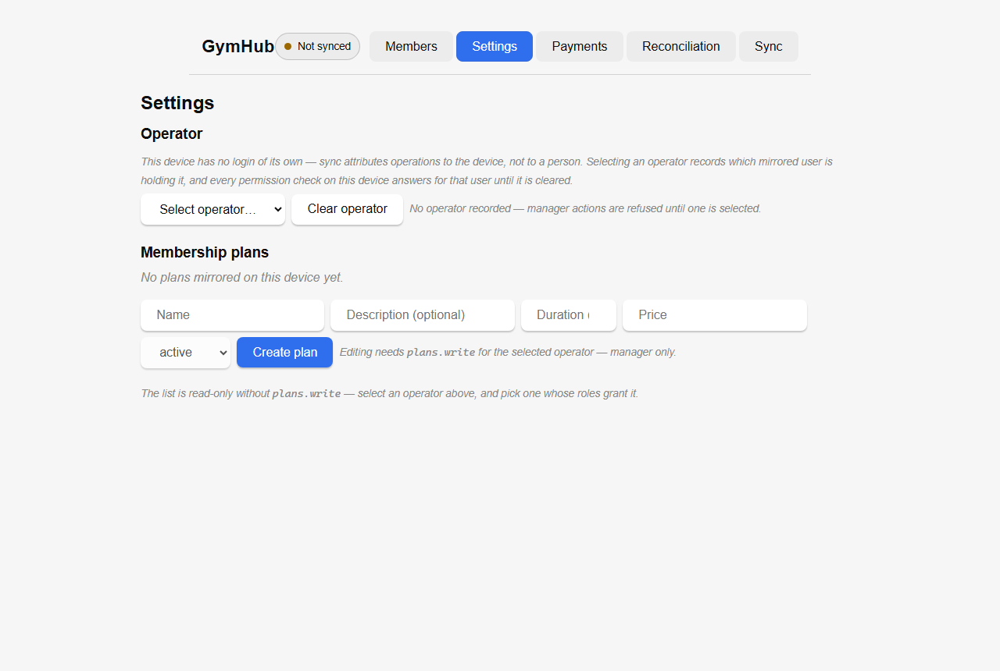
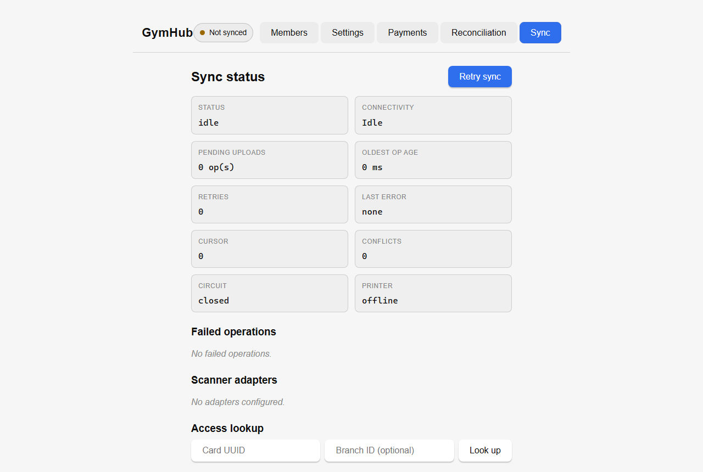

# GymHub — Offline-First Gym Management Platform

> A multi-tenant gym platform with a desktop front-desk app that keeps working with no network: members, memberships, renewals, payments, reconciliation and a sync engine that reconciles exactly once.

| | |
|---|---|
| **Role** | Solo — architecture, backend, desktop app, sync engine, CI |
| **Timeline** | 2026 – present · active development |
| **Stack** | Laravel 12 API · PostgreSQL 16 · Redis · React 19 + TypeScript (web/PWA) · Tauri 2 · Rust · SQLite (WAL) · GitHub Actions |
| **Evidence** | 138 backend tests / 1,602 assertions · 54 Rust tests · 3-job CI matrix |

> **The source code for this project is private.** This repository is a technical case study with real screenshots from the running desktop client. Code walkthroughs available on request.

---

## The problem

Gyms run at the front desk: a member walks in, the receptionist finds them, checks or renews a membership, takes a payment, and prints or scans a card. This happens at 6 a.m., on a tablet or cheap laptop, over a connection that is often down.

A cloud-only system stops that queue. A local-only system loses the owner's reporting. GymHub is built as a **local-first desktop application with a certified multi-tenant cloud backend**, where the desktop owns the front-desk experience and the cloud owns identity, tenancy, reporting and payments.

---

## Product tour

### Desktop members

The desktop shell carries the whole front-desk surface — members, membership plans, payments, reconciliation and sync — with the sync state always visible in the top bar.

### Operator identity and permissions

The device has no login of its own. Sync attributes operations to the *device*, and a local operator is selected on top of it. Every permission check on the device answers for that operator, which is how a shared front-desk machine still has accountability without storing cloud credentials. The screen states the rule directly: manager actions are refused until an operator is selected.

### Sync status

Every field the sync engine knows is exposed to the operator: status, connectivity, pending uploads, oldest pending operation age, retries, last error, cursor position, conflicts, circuit-breaker state and printer state — plus failed operations, scanner adapters and an access-card lookup.

---

## Engineering deep dive

### Tenancy and authorisation (cloud)

- Multi-tenant schema with tenant isolation proven **on every route** (not just the happy path)
- Hand-rolled RBAC rather than a package, so the permission surface stays auditable
- Device registration and revocation; device-token-gated sync endpoints
- Append-only audit log across the tenant

### Sync engine

| Direction | Mechanism |
|---|---|
| **Push** (device → cloud) | Per-tenant outbox, all-or-nothing, idempotent; replaying a batch returns the same result |
| **Pull** (cloud → device) | Cursor-gated batches with tombstones, so deletions converge too |
| **Auth** | Device token, revocable server-side |
| **Reconciliation** | Exactly-once application on the desktop, with a durable `sync_operations` queue |

### Desktop core (Rust)

- **Rust owns SQLite.** WAL mode, single writer, no direct database access from the React layer — the UI calls commands, the commands own transactions.
- A durable `sync_operations` queue survives crashes and resumes where it stopped.
- An async sync engine with **exponential backoff and a circuit breaker**, so a flaky connection degrades gracefully instead of hammering the API.
- Typed events (`sync:status`) push state to the UI — the operator never polls.
- **Hardware adapter seam**: scanners and printers are behind an interface with a printing bridge, so the app can be developed and tested without the physical device.
- An access projector/lookup runs against a versioned source contract, which is what makes card-based check-in deterministic.

### Cross-cutting conventions

- Three-job CI matrix on `main` and PRs: backend (PostgreSQL service container, migrations against pgsql, tests against in-memory SQLite), web (lint, tests, build) and desktop (Rust toolchain + Tauri system deps, `cargo test`, frontend build).
- Specs and implementation plans are checked in per phase (`docs/superpowers/specs`, `plans`), with a milestone record including **documented known limitations** — e.g. attribution falling back to `unregistered` until device onboarding lands.
- Payments are modelled as verified state transitions with provider webhooks (Korapay and Fincra integration phases).

### Decisions worth calling out

1. **Local-first, not offline-tolerant.** The desktop database is the working copy. Sync is a background process with its own health model.
2. **All-or-nothing push.** Partial batches create ambiguous state; the engine refuses them and retries as a unit.
3. **Tombstones over hard deletes.** Deletion has to converge too, otherwise devices resurrect records forever.
4. **Surface the engine.** Operators get retries, conflicts and circuit state as first-class UI, because silent failure in a payment queue is worse than a visible error.
5. **Tests as the exit criteria.** The v1.0 milestone closed on 138 passing backend tests and 54 passing Rust tests, not on "it looks done".

---

## Status

v1.0 shipped: certified foundation, multi-tenant auth/RBAC/device/audit backend, and the offline database + sync engine. Payments (Korapay, Fincra) are the current workstream, followed by the full member-facing web client.

This is deliberately an honest work-in-progress showcase: the screenshots show the desktop shell running against a browser preview, which is why the sync panel renders in an idle/empty state — the Tauri host provides the native SQLite layer and printer bridge.

---

## Why this project is representative

GymHub is the purest example of my offline-first approach: two databases, one contract, and an obsession with exactly-once semantics. It is also where most of the AI-assisted workflow paid off — a large surface (Laravel API, React client, Rust core) delivered phase by phase against written specs, with test counts as the gate for each milestone.
