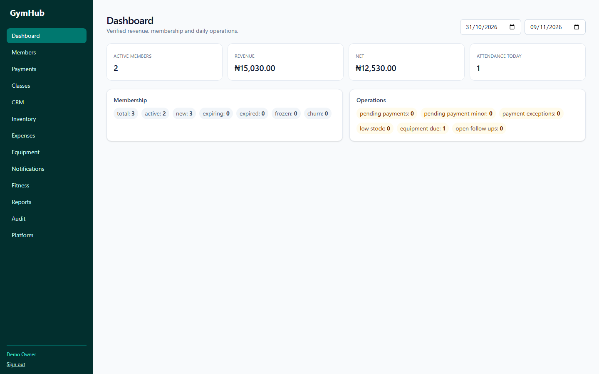
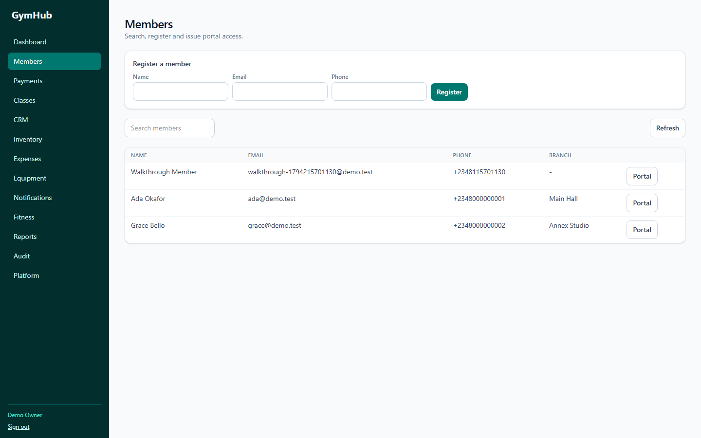
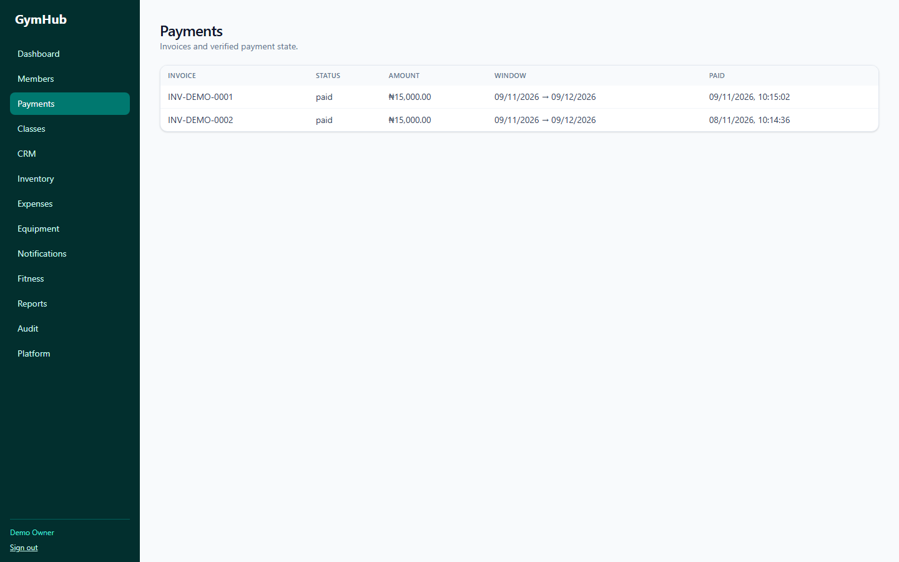
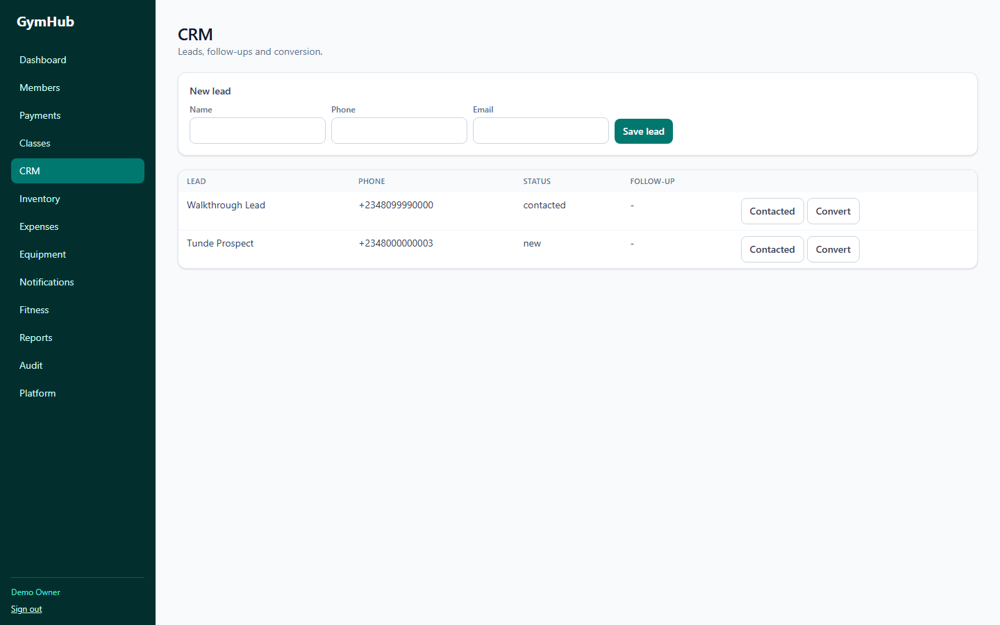
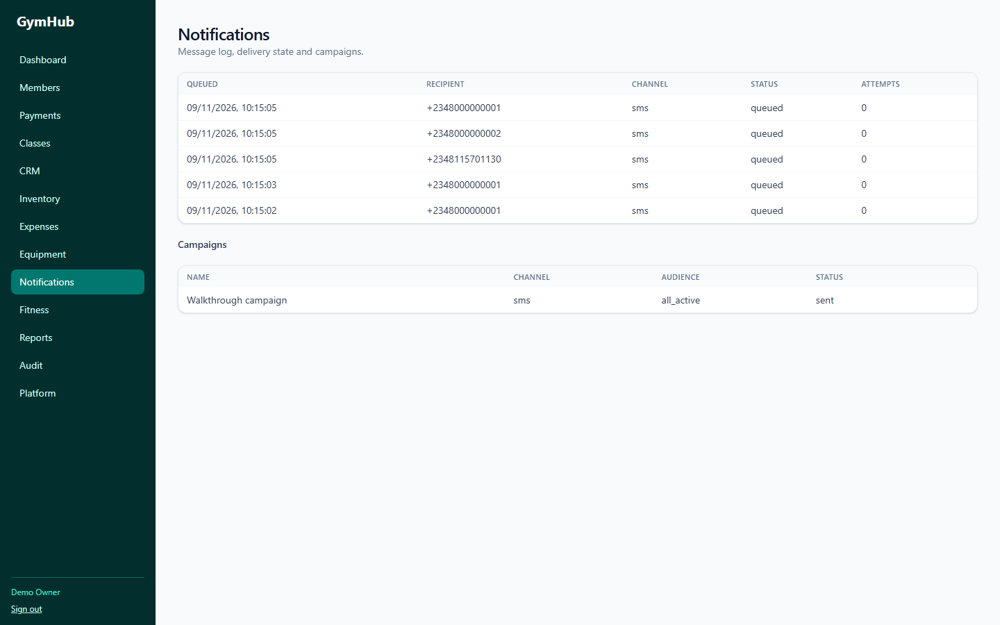
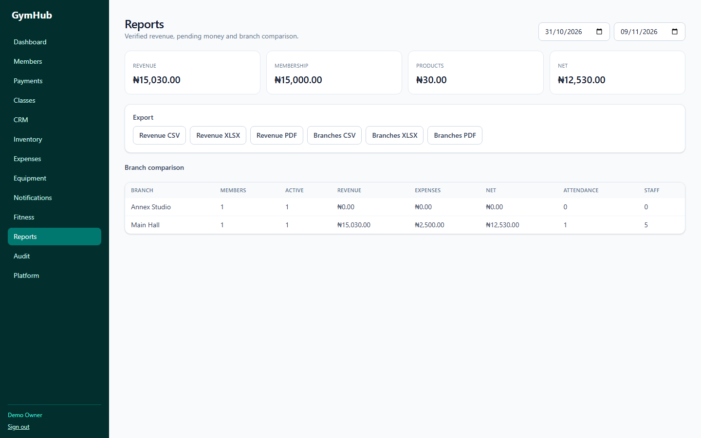
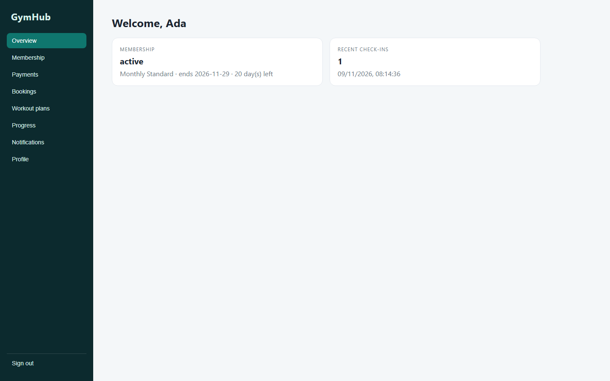
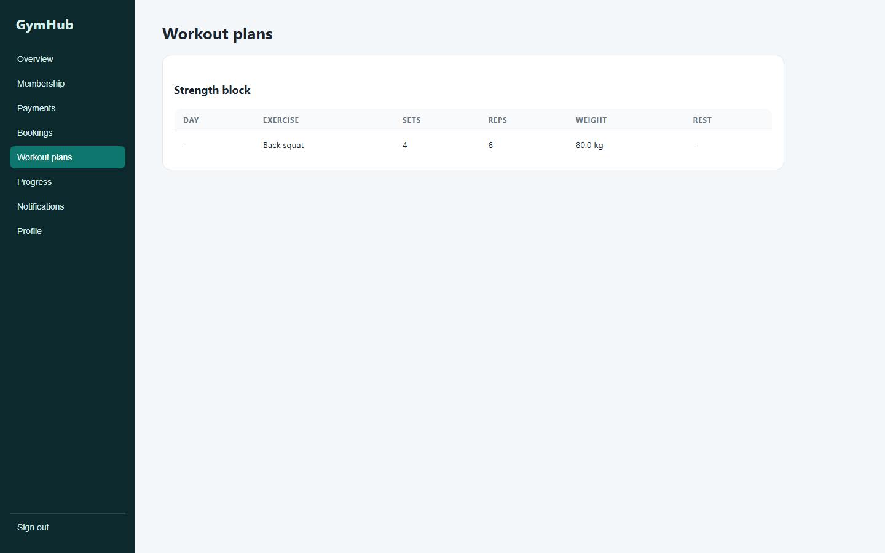
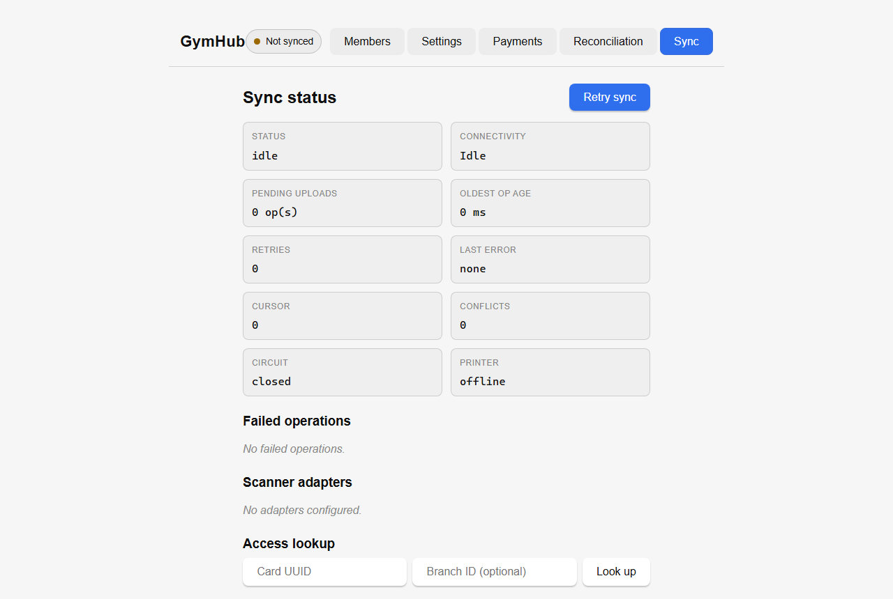
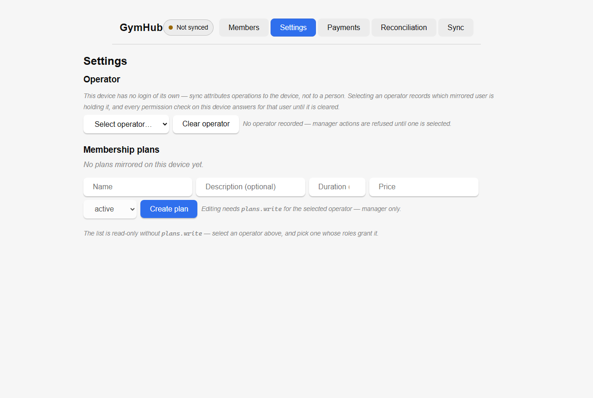

# GymHub — Offline-First Gym Management Platform

> A multi-tenant gym platform with three surfaces: a staff web client, a member portal, and a local-first desktop front desk that keeps selling memberships and taking payments with no network.

| | |
|---|---|
| **Role** | Solo — architecture, backend, web client, member portal, desktop app, sync engine, CI and production readiness |
| **Timeline** | 2026 – present · 224 commits · 24 delivery phases |
| **Stack** | Laravel 12 API · PostgreSQL 16 · Redis · React 19 + TypeScript (staff client) · Vite · Tailwind CSS 4 · Tauri 2 · Rust · SQLite (WAL) · Playwright · GitHub Actions |
| **Evidence** | 22/22 API walkthrough checks · 3/3 Playwright browser checks · 138 backend tests / 1,602 assertions at v1.0 plus later suites · 54 Rust tests |

> **The source code for this project is private.** This repository is a technical case study with real screenshots from the running staff client and member portal. Code walkthroughs available on request.

---

## The problem

Gyms run at the front desk: a member walks in, reception finds them, checks or renews a membership, takes a payment, and prints or scans a card. This happens at 6 a.m., on a cheap laptop, over a connection that is often down.

A cloud-only system stops that queue. A local-only system loses the owner's reporting. GymHub is built as a **local-first desktop application with a certified multi-tenant cloud backend** — the desktop owns the front-desk experience, the cloud owns identity, tenancy, billing, reporting and the member relationship.

---

## Three surfaces, one product

| Surface | Who uses it | What it does |
|---|---|---|
| **Staff web client** | Owner, manager, receptionist, accountant, stock, trainer | Full operations: members, payments, classes, CRM, inventory, expenses, equipment, notifications, reports, audit, platform |
| **Member portal** | Members | Membership status, invoices, bookings, workout plans, progress and BMI, notifications, profile |
| **Desktop app (Tauri)** | Front desk, offline shifts | Check-in, POS, memberships, payments, reconciliation, branch operations — all local-first |

---

## Product tour

### Staff workspace



Verified revenue, net, active members and attendance for a date range, plus a membership funnel and an operations strip — pending payments, payment exceptions, low stock, equipment due, open follow-ups. The dashboard is built from verified money only: an intent that has not been confirmed by a provider or the offline verification path does not count as revenue.



Member records with branch assignment, search, registration and a one-click portal hand-off.



Invoices with verified payment state and their service window.

### Operations



Leads, follow-ups and conversion — including trials, referrals and promotions — as a pipeline rather than a spreadsheet.



A provider-neutral notification engine: queued messages with channel, status and attempt counts, campaign audiences, delivery webhooks and scheduled scans (membership expiry, equipment service).



Verified revenue by source, branch comparison across members, revenue, expenses, net, attendance and staff, with CSV, XLSX and PDF exports.

### Member portal





A standalone portal app: membership status and days remaining, check-in history, bookings, assigned workout plans with sets/reps/weight, progress entries and BMI, notifications and profile.

### Desktop front desk





The desktop device has no login of its own: sync attributes operations to the device, and a local operator is selected on top of it. Every permission check on the device answers for that operator — which is how a shared front-desk machine stays accountable without storing cloud credentials.

---

## What is in the system

### Membership and money
- Members, branches, membership plans, renewals, freezes and churn tracking
- Invoices, receipts and payments with **provider-neutral** handling: Korapay, Fincra, and a fake provider for deterministic tests
- **Offline payment verification**: a desk can take a payment while disconnected and have it verified and reconciled exactly once when connectivity returns
- Refunds, payment exceptions and reconciliation

### Front desk and access
- Check-in with access events, attendance history and card/UUID lookup
- Access projector fed by a versioned source contract, with a printing bridge and scanner adapter seam

### Training
- Classes, sessions, capacity, waitlists and attendance
- Trainers, PT credits, trainer portal and bookings
- Member workout plans and progress tracking

### Retail and operations
- Inventory ledger with stock receipts linked to **POS sales**; offline POS capture with mirror tables
- Equipment register with warranty, append-only maintenance history and offline maintenance capture
- Expenses with categories, attachments and a pending-approval workflow
- Verified-revenue reporting with CSV/XLSX/PDF exports

### Growth
- CRM: leads, trials, referrals, promotions and retention services synced to the desktop
- Notification campaigns (SMS/email), delivery webhooks, scheduled scans

### Multi-branch and platform
- Branch grants on the desktop, offline branch enforcement, cross-branch policy, staff assignments and branch comparison
- **Platform control plane**: tenant lifecycle, feature flags, provider availability and read-only support sessions (read allowed, writes 403, revocation ends the session)

---

## Architecture

```
┌──────────────────┐   ┌──────────────────┐   ┌──────────────────────┐
│ Staff web client │   │ Member portal    │   │ Desktop (Tauri 2)    │
│ React 19 + Vite  │   │ React + Vite     │   │ React + Rust + SQLite│
└────────┬─────────┘   └────────┬─────────┘   └──────────┬───────────┘
         │                      │                        │
         └──────────┬───────────┘                        │ push / pull
                    │  JSON /api/v1                     │ (device token)
          ┌─────────▼──────────┐              ┌──────────▼───────────┐
          │ Laravel 12 API     │◄─────────────│ Sync engine          │
          │ multi-tenant       │              │ outbox · backoff ·   │
          │ RBAC · policies    │              │ circuit breaker      │
          │ queues · scheduler │              │ exactly-once apply   │
          └─────────┬──────────┘              └──────────────────────┘
                    │
        ┌───────────┴───────────┐
        │ PostgreSQL · Redis    │
        └───────────────────────┘
```

### The sync engine

- **Push** (device → cloud): per-tenant outbox, all-or-nothing, idempotent — replaying a batch returns the same result.
- **Pull** (cloud → device): cursor-gated batches with tombstones, so deletions converge too.
- **Auth**: device token, revocable server-side; branch grants are enforced offline from the last signed scope.
- **Desktop core**: Rust owns SQLite (WAL, single writer); a durable `sync_operations` queue survives crashes; async engine with exponential backoff and a circuit breaker; typed `sync:status` events drive the UI.
- **Exactly-once**: payment verification, POS sales and equipment maintenance each have an integration test that interrupts the flow and proves the operation is not applied twice.

### Decisions worth calling out

1. **Local-first, not offline-tolerant.** The desktop database is the working copy; sync is a background process with its own health model.
2. **Verified money only.** Reports read from verified payments. Pending intents are visible but never counted as revenue.
3. **All-or-nothing push.** Partial batches create ambiguous state; the engine refuses them and retries as a unit.
4. **Surface the engine.** Operators see retries, conflicts, queue depth and circuit state, because silent failure in a payment queue is worse than a visible error.
5. **Platform and tenant are separate planes.** Support sessions are read-only by construction, with an explicit write-denied test.

---

## Hardening and production readiness

Phase 22 added an evidence-based security pass rather than a checklist:

| Check | Result |
|---|---|
| Route authentication/authorisation audit | all 233 API routes accounted for; every staff mutation permissioned |
| Role → route matrix | 120 assertions across 6 roles × 11 modules |
| Cross-tenant probes | foreign rows 404; lists, branch filters and device lists do not leak |
| Login rate limits | 10 attempts allowed, 11th returns 429 |
| Upload hardening | SVG, oversize and traversal filenames rejected; files private |
| Redis outage + database restore | reads survive cache loss; SQLite backup/restore verified |
| Secret and dependency scans | 730 tracked files scanned; Composer, npm and Rust advisories cleared |

Production readiness covers the runbook, disaster recovery, backup and restore drills, monitoring, provider webhook registration, and a signed updater with a dry-run manifest drill. The full walkthrough (`docs/operations/walkthrough-report.md`) exercises 22 API steps and 3 browser flows against a live stack — 22/22 and 3/3 passing on the latest rerun.

---

## Status

Phases 0–23 delivered: foundation, auth/tenancy, offline sync, members, memberships, payments (Korapay, Fincra), provider abstraction, offline payment verification, attendance/access, staff and trainers, classes and PT, CRM, inventory and POS, expenses and reporting, equipment, notifications, member portal, management dashboard, multi-branch, platform control plane, hardening and production readiness.

Current work is on release engineering and the web fitness/updater track.

---

## Why this project is representative

GymHub is the purest example of my offline-first approach: two databases, one contract, and an obsession with exactly-once semantics. It is also the best evidence of how I use AI-assisted delivery on a long-lived system — 24 phases shipped against written specs, with test counts, walkthroughs and hardening reports as the gate for each milestone rather than a feeling that it works.
